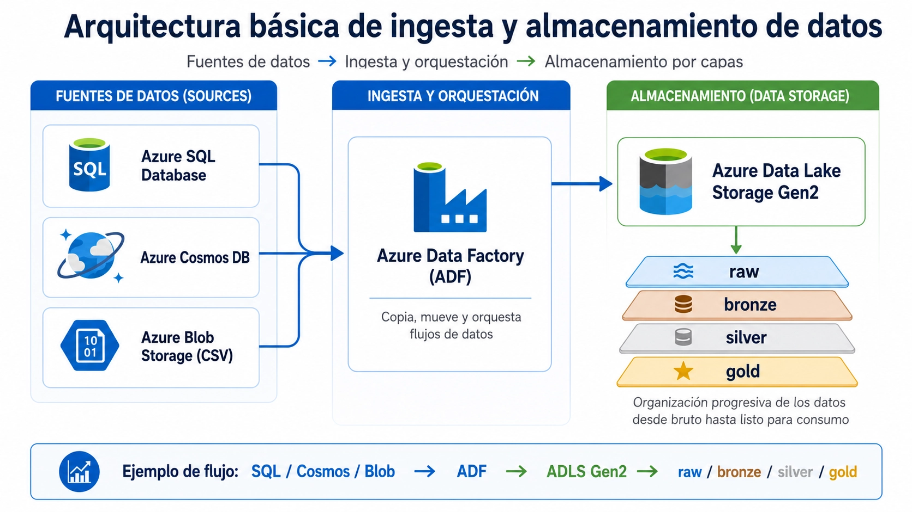

Practica 02 - Ingesta de distintas fuentes hacia un mismo Datalake
Due September 11, 2026 11:59 PM
•
Multiple submissions allowed
Instructions
Caso de uso.
RetailNova es una gran compañía que, debido a su rápida expansión y a la adquisición de otras marcas, tiene la información de su principal caso de uso (clientes y ventas) fragmentada en tres tecnologías de almacenamiento diferentes. Su objetivo es unificar todos estos registros para tener una visión global del negocio.

RetailNova tiene la siguiente distribución de datos:

Azure SQL Database: Almacena los clientes y las ventas estructuradas generadas actualmente en sus tiendas físicas.
Azure Cosmos DB: Almacena registros de clientes y ventas generados por una plataforma e-commerce de reciente adquisición (datos almacenados como documentos JSON).
Azure Blob Storage: Almacena el histórico de clientes y ventas de sistemas legados de la última década (datos almacenados como archivos CSV).
Destino analítico: Necesidad futura de consolidar todos estos datos para construir modelos analíticos y paneles de informes en Power BI.
Para lograr esta unificación, se diseña una arquitectura donde un único orquestador se conecta a las tres fuentes de forma centralizada:

Practica 02 - Ingesta de distintas fuentes hacia un mismo Datalake
Due September 11, 2026 11:59 PM
•
Multiple submissions allowed
Instructions
Caso de uso.
RetailNova es una gran compañía que, debido a su rápida expansión y a la adquisición de otras marcas, tiene la información de su principal caso de uso (clientes y ventas) fragmentada en tres tecnologías de almacenamiento diferentes. Su objetivo es unificar todos estos registros para tener una visión global del negocio.

RetailNova tiene la siguiente distribución de datos:

Azure SQL Database: Almacena los clientes y las ventas estructuradas generadas actualmente en sus tiendas físicas.
Azure Cosmos DB: Almacena registros de clientes y ventas generados por una plataforma e-commerce de reciente adquisición (datos almacenados como documentos JSON).
Azure Blob Storage: Almacena el histórico de clientes y ventas de sistemas legados de la última década (datos almacenados como archivos CSV).
Destino analítico: Necesidad futura de consolidar todos estos datos para construir modelos analíticos y paneles de informes en Power BI.
Para lograr esta unificación, se diseña una arquitectura donde un único orquestador se conecta a las tres fuentes de forma centralizada:

Solo nos centraremos en la parte inicial de esta arquitectura (la ingesta unificada):

crear las fuentes de datos simulando los tres entornos de origen;
entender el tipo de dato que provee cada fuente (relacional, NoSQL documental y archivos planos);
seleccionar el almacenamiento idóneo (ADLS Gen2);
configurar un único Azure Data Factor (puedes usar varios pipelines) y con servicios vinculados (Linked Services) a las tres fuentes y al Data Lake;
copiar datos de forma centralizada hacia la primera zona de aterrizaje (raw/clientes/ y raw/ventas/ y raw/histórico
FORMATO DE ENTREGA: PREFERIBLEMENTE MARKDOWN (o repo de GitHub) , puedes entregar en pdf  o word o powerpoint
My work

Attach
Upload from this device
No se ha seleccionado ningún archivo
New

Solo nos centraremos en la parte inicial de esta arquitectura (la ingesta unificada):

crear las fuentes de datos simulando los tres entornos de origen;
entender el tipo de dato que provee cada fuente (relacional, NoSQL documental y archivos planos);
seleccionar el almacenamiento idóneo (ADLS Gen2);
configurar un único Azure Data Factor (puedes usar varios pipelines) y con servicios vinculados (Linked Services) a las tres fuentes y al Data Lake;
copiar datos de forma centralizada hacia la primera zona de aterrizaje (raw/clientes/ y raw/ventas/ y raw/histórico
FORMATO DE ENTREGA: PREFERIBLEMENTE MARKDOWN (o repo de GitHub) , puedes entregar en pdf  o word o powerpoint
My work

Attach
Upload from this device
No se ha seleccionado ningún archivo
New
